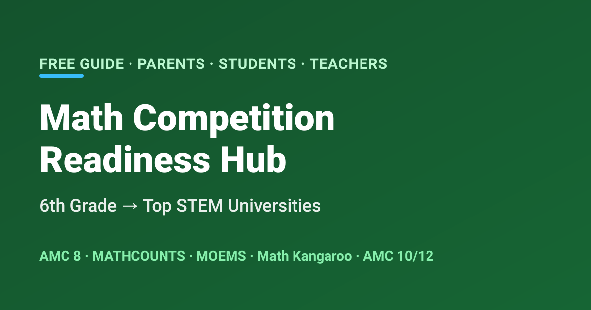

<p align="center">
  
</p>

<h1 align="center">Math Competition Readiness Hub</h1>

<p align="center">
  A free, open guide helping <strong>parents, students, and teachers</strong> navigate the U.S. math-competition pathway — from 6th grade to top STEM universities.
  <br>
  <a href="https://vineetagrwal.github.io/math-dance-pathway/"><strong>🔗 View the live site →</strong></a>
</p>

<p align="center">
  
  
  
</p>

---

## What this is

A single, self-contained web page — no build step, no dependencies — that lowers the barrier to entry for math competitions by covering:

- 🏫 **Early school test-site registration** & key deadlines
- 📚 **Weekly preparation habits** and the 3-phase annual cycle
- 📝 **Free mock-test archives** and a full contest calendar (AMC 8, MATHCOUNTS, MOEMS, Math Kangaroo, Math League, AMC 10/12)
- 🎯 **The long-term pathway** from middle-school contests to top STEM universities
- 🤝 **How to build a local Math Circle** from scratch

## Who it's for

| Audience | What they get |
|----------|---------------|
| **Parents** | A simple "start here" path, deadlines, cost clarity, and a ready-to-send email template |
| **Students** | Free practice archives, a low-stakes on-ramp, and a clear progression |
| **Teachers** | A turnkey hosting kit proving a contest is only a single ~40-minute session |

## Run locally

No build step — just open the file:

```bash
open index.html          # macOS
# or serve it:
python3 -m http.server 8000   # then visit http://localhost:8000
```

## Project structure

```
math-dance-pathway/
├── index.html      # the entire site (HTML + CSS + JS in one file)
├── og-image.svg    # social-share preview image
├── sitemap.xml     # SEO
├── robots.txt      # SEO
├── README.md
└── LICENSE
```

Hosted on **GitHub Pages** from the `main` branch root. Any push to `main` redeploys automatically within ~1–2 minutes.

## Contributing

Corrections and additions are welcome — especially updated deadlines, dead-link fixes, and new free resources.

- 🐛 **Found something wrong?** [Open an issue](https://github.com/vineetagrwal/math-dance-pathway/issues)
- 📋 **Planning & roadmap** live in the [project wiki](https://github.com/vineetagrwal/math-dance-pathway/wiki) (PRD, Backlog, Growth & Awareness Plan)
- ✏️ **Small fix?** Edit `index.html` and open a pull request — it's one file, easy to review

Please keep contributions accessible (semantic HTML, `aria-label`s, and `rel="noopener noreferrer"` on external links) and prefer **free** resources to lower the cost barrier.

## License

[MIT](LICENSE) — free to use, adapt, and share. An open educational resource.
